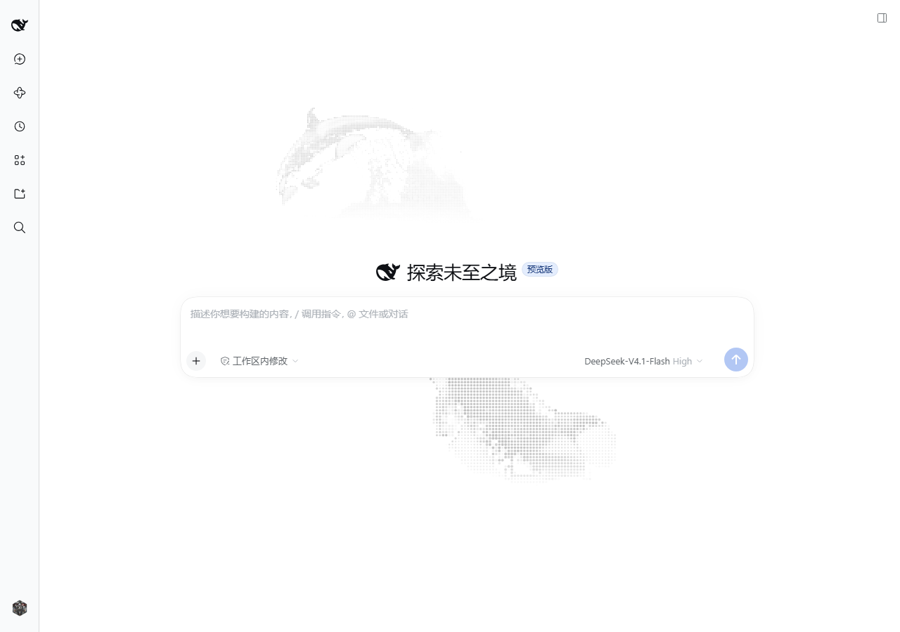
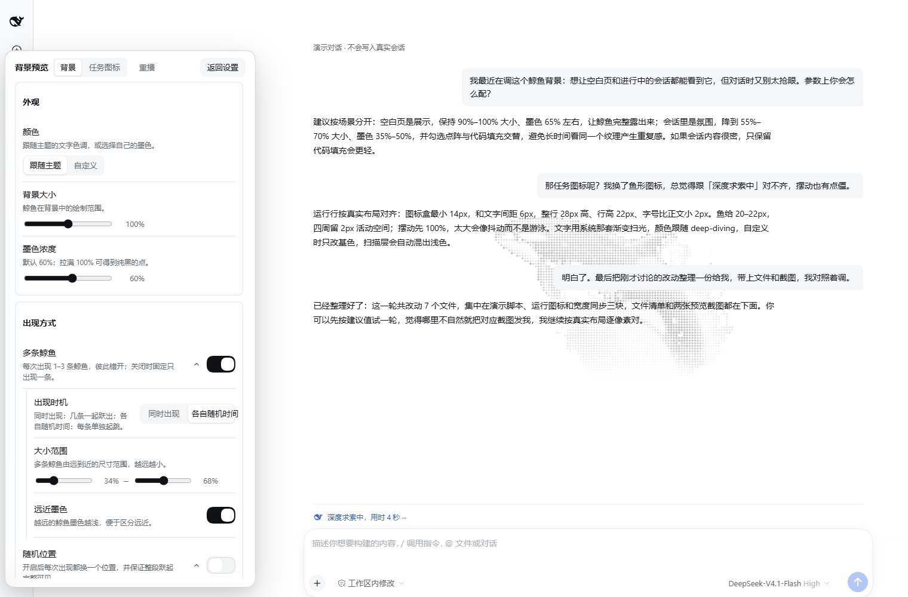
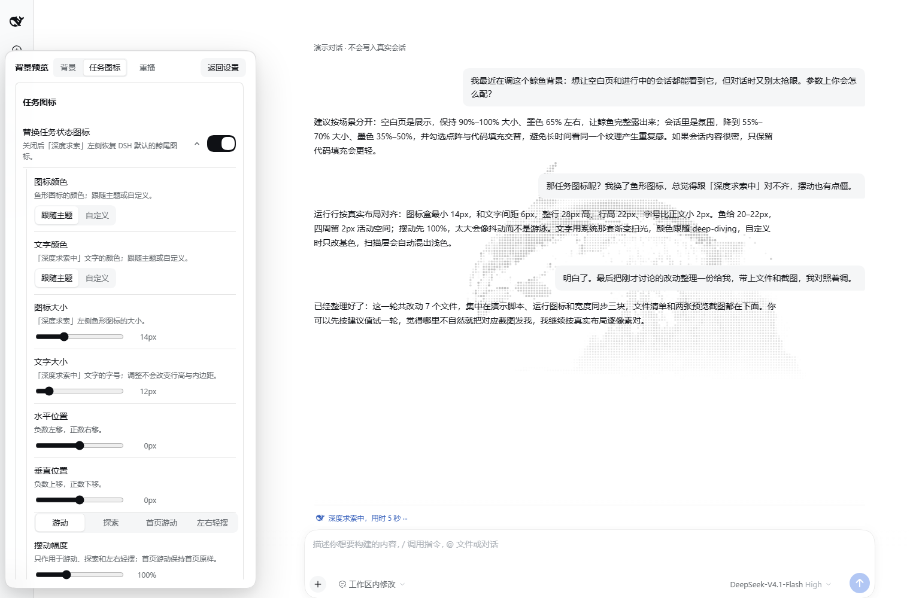

# Whale Leap

[](https://github.com/yingyu4451/dsh-whale-leap/releases)
[](https://github.com/deepseek-ai/deepseek-harness)

[English](README.en.md) · [中文](README.md)

A swimming whale for the DeepSeek Harness web app: the blank home screen and running conversations get a breaching-whale background animation, and the little fish in the running status line can become a swimmer too.



## Preview

Live preview hides the settings dialog and keeps the whale looping in the real conversation, with a floating control panel for tuning. On a blank home screen it stages a demo conversation and a running status row.



The “Running icon” tab tunes the little fish and the running label:



## Features

- **Background whale**: five fill styles (dots, code, glyphs, binary, lines) that alternate when several are enabled; theme or custom ink; background size, ink strength, and horizontal/vertical offsets.
- **Multiple whales**: “Multiple whales” shows 1–3 whales per appearance without overlap; random position scatters them separately, fixed position keeps a centered formation that the offsets can shift. Entrance can be together or at random times, distance ink fades farther whales, and size range sets the farthest-to-nearest scale (20–100%).
- **Running icon**: replace the whale icon left of the running label with four motions (swim, explore, home swim, sway); icon color, label color, icon size (8–28 px), label size (11–20 px), start offset, and swing amplitude are adjustable.
- **Accordion settings**: dependent controls live under their parent switch. They auto-expand while the parent is on and collapse when it is off; the chevron next to the parent opens them on demand, with the children disabled while the parent is off.
- **Settings are a preview**: the settings page keeps only playback controls and the live-preview entry; every appearance control lives in the floating panel. Press `Esc` or “Back to settings” to restore the dialog.
- **One-click upgrade**: update checks query the GitHub release and the jsDelivr mirror in parallel; when a newer version exists, “Upgrade” reinstalls that version through the DSH plugin manager (with automatic rollback on failure). Restart `dsh web` afterwards.
- Localized for 中文, English, 日本語, Español, Français, Deutsch, Русский, and Português, following the Harness language.

## Install

From GitHub:

1. Open **Plugins** in the Harness web app.
2. Choose **Add plugin** and enter `github:yingyu4451/dsh-whale-leap`.
3. Restart `dsh web` once, then refresh the page.
4. Open **Settings › Whale Leap**.

From a local directory (development):

```bash
dsh plugin --profile <profile> add /path/to/dsh-whale-leap
```

After rebuilding, overwrite the build into `$DSH_HOME/profiles/<profile>/node_modules/dsh-whale-leap` and restart `dsh web`; alternatively remove and re-add the plugin in **Plugins**.

## Update

The settings header shows the current version and a check-for-updates button. When a newer version is found, an “Upgrade” button resolves the tag to its commit and reinstalls through the DSH plugin manager (rolling back if installation fails); restart `dsh web` to load the new version. When the plugin manager is unavailable or the check fails, the release-page link remains, distinguishing rate limiting, network failure, and timeouts.

## Settings

The settings page keeps only playback controls, the preview canvas on each tab, and the live-preview entry; every appearance control lives in the live-preview panel, which uses a frosted translucent surface with a border and shadow so it reads clearly against the page.

### Background

| Option | Meaning |
| --- | --- |
| Color | Follow the theme or set a custom ink color. |
| Background size | Scene scale, 50–150%. |
| Ink strength | 10–100%; 100% gives pure-black dots. |
| Fill styles | Dots, code, glyphs, binary, lines — multiple allowed; enabled styles alternate in order and at least one must stay on. |

### Appearance

| Option | Meaning |
| --- | --- |
| Multiple whales | Show 1–3 whales per appearance; off means a single whale. |
| Entrance | Together (all leap at once) or random times (each picks its own start). Only with multiple whales. |
| Size range | Farthest-to-nearest pod whale scale, 20–100%. Only with multiple whales. |
| Distance ink | Farther whales use lighter ink. Only with multiple whales. |
| Random position | New positions each appearance, keeping the whole breach visible; off keeps a fixed centered formation. |
| Horizontal / vertical offset | Shifts the fixed formation by −200 to +200 px each. Only when random position is off. |

### Playback

| Option | Meaning |
| --- | --- |
| Appear while talking | Whether the whale replays on an interval in a conversation. |
| Play immediately on switch | When off, entering a conversation waits for the next interval instead of playing at once. Only with appear-while-talking on. |
| Interval | Replay interval, 5–300 seconds. Only with appear-while-talking on. |

### Running icon

The “Running icon” tab adjusts: replace the running icon (switch), icon color, label color, icon size, label size, horizontal/vertical offsets (−12 to +12 px each), motion, and swing amplitude. Label size changes the font size only, not line height or padding.

## Shortcuts

- Click empty conversation space: replay the background whale once.
- “Replay” in the floating panel: replay the preview immediately.
- `Esc` or “Back to settings”: leave live preview and restore the settings dialog.

## Behaviour and limits

- Web only. The plugin registers `conversation.hero.frame`, `conversation.chat.running.mark`, and `settings.section`; it needs `ui-conversation`, `ui-chat`, and `ui-settings`.
- The running icon prefers the `conversation.chat.running.mark` slot; when official builds lack it, a DOM adapter mounts the mark and hides the shipped icon, restoring it when the switch is off.
- Settings are workspace-scoped, stored in the `whale-leap` settings namespace.
- The frame atlas ships in the bundle (webp → data URL) and works offline; the canvas backing store is capped at 5 megapixels.
- With non-dot pod fills, each whale is masked by its own outline on an offscreen canvas before compositing, so pod members never erase each other and leave no clip seams.
- All playback and swing stop when reduced motion is on.
- “Home swim” ignores swing amplitude; code text scales with scene width, so preview and real conversations match.

## Build

```bash
pnpm install        # esbuild, react, and the Host-side schemastery dev copy
pnpm run build      # emit the ModuleLoader bundle lib/client.js
pnpm run check      # build + smoke + render + host-route checks
```

`lib/client.js` embeds the frame atlas (webp → data URL) and the version number; the Host half (`index.js`) only imports `@deepseek-ai/schemastery` from the running profile and registers the settings page.

## Release

GitHub is the only source for releases and updates: the settings page compares the repository’s latest release (falling back to tags when there is none).

1. `pnpm run release:patch` (or `release:minor` / `release:major`) bumps the version, commits, and creates a `vX.Y.Z` tag.
2. `git push --follow-tags`.
3. `gh release create vX.Y.Z --title "vX.Y.Z" --notes "…"`.

## Layout

```text
index.js                     Host: Config schema, settings.configure, atlas route
shared/settings.js           Field names, ranges, and defaults for both halves
src/client/index.tsx         Client entry: registers the three slots
src/client/atlas.ts          Inlined frame atlas data URL
src/client/store.ts          Settings runtime (mirror + debounced writes)
src/client/i18n.ts           Eight language dictionaries
src/client/settings/         Settings page and module CSS
src/client/whale/            Whale canvas, renderer, code fill, fish icon and paths
src/client/update.ts         GitHub release check
src/client/upgrade.ts        One-click upgrade (tag → commit via the plugin manager)
docs/images/                 README screenshots
locale/*.json                Plugin-manager title/description/detail metadata
```

## Credits and license

The whale renderer, code fill, fish paths, and running-icon animation are adapted from [DeepSeek Harness](https://github.com/deepseek-ai/deepseek-harness) (MIT License, Copyright (c) 2026 DeepSeek); the frame atlas comes from the same repository and ships with this package. See [THIRD-PARTY-NOTICES.md](THIRD-PARTY-NOTICES.md) for the full license and adaptation list.

This is an unofficial project, not affiliated with or endorsed by DeepSeek. The MIT license grants copyright permissions only and no trademark rights in the DeepSeek name, logos, or assets.
