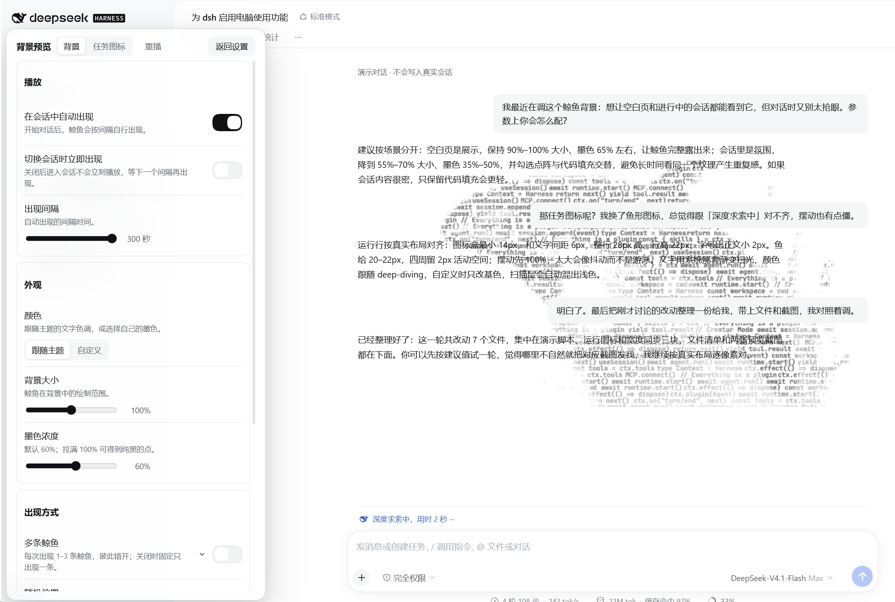

# Whale Leap

[](https://github.com/yingyu4451/dsh-whale-leap/releases)
[](https://github.com/deepseek-ai/deepseek-harness)

[English](README.md) · [简体中文](README.zh.md)

The whale-wallpaper animation added in DSH 0.2.2-rc.2 now also appears inside ongoing conversations, and the small mark to the left of the “Deep diving” status can be replaced with an animated DeepSeek logo.



## Preview

Live preview hides the settings dialog and replays the whale in the real conversation while a floating panel stays open for tuning. On the blank home — where there is no conversation yet — it stages a demo transcript and a running row, so the animation can still be judged against a realistic layout.

## Features

- **Background whales** — dot matrix, code, glyph, binary and line fills, with any number of them rotating. Ink follows the theme or a custom colour; background size, ink strength and horizontal/vertical offsets are adjustable.
- **Pods** — with *Multiple whales* on, each appearance brings 1–3 whales that never overlap. Random position scatters them and keeps every breach on screen; with random position off they hold a fixed formation that the offsets move as a group. Entrance timing can be *together* or *independent*; distance ink fades far whales; size range sets the farthest-to-nearest sizes (20%–100%).
- **Running icon** — replaces the small fish beside the “Deep diving” status with a pixel whale. Motions: swim, explore, home swim and sway; icon/text colours, sizes (8–28 px / 11–20 px), offsets and swing amplitude are adjustable.
- **Accordion settings** — dependent options live under their parent switch: expanded automatically when the parent is on, collapsed when it is off, and can be peeked at any time with the chevron next to the parent while the children stay disabled.
- **Settings are the preview** — all appearance controls are tuned in the floating panel, which sits on a frosted, outlined surface so it reads clearly against the page. `Esc` or *Back to settings* restores the settings dialog.
- **One-click upgrade** — *Check for updates* queries the GitHub release and the jsDelivr mirror in parallel. *Upgrade* resolves the tag to its commit and reinstalls the plugin through the DSH plugin manager, rolling back if the install fails. The restart prompt matches the shell: restart `dsh web` in a browser, restart the DSH app on desktop.
- **Daily check** — the first time the Whale Leap settings are opened each day, the update check runs once; same-day revisits stay quiet.
- **Eight locales** out of the box: 简体中文, English, 日本語, Español, Français, Deutsch, Русский, Português.

## Install

From GitHub:

1. Open **Plugins** in the Harness web app.
2. Choose **Add plugin** and enter `github:yingyu4451/dsh-whale-leap`.
3. Restart `dsh web` once, then refresh the page.
4. Open **Settings › Whale Leap**.

From a local checkout (development):

```bash
dsh plugin --profile <profile> add /path/to/dsh-whale-leap
```

After rebuilding, copy the new build over `$DSH_HOME/profiles/<profile>/node_modules/dsh-whale-leap` and restart `dsh web`; alternatively remove and re-add the plugin in Plugins.

## Update

The settings header shows the current version and a **Check for updates** button. When a newer version is found, an **Upgrade** button appears: it resolves the release tag to its commit and reinstalls that exact revision through the DSH plugin manager (a failed install rolls back automatically). Restart `dsh web` afterwards to load the new build. If the plugin manager is unavailable or the check fails, the row keeps a link to the release page and distinguishes rate limiting, network errors and timeouts.

## Settings

The settings page keeps only playback controls, a preview canvas per tab, and the *Live preview* entry; every appearance control lives in the floating panel.

### Playback

| Option | Meaning |
| --- | --- |
| Appear automatically in conversations | Whether the whale appears on its own once a conversation starts. |
| Play immediately on conversation switch | When off, entering a conversation waits for the next interval instead of replaying at once. Available only while auto-appear is on. |
| Appearance interval | Minutes and seconds pickers, 5 s–59 min 59 s. Available only while auto-appear is on. |
| Random interval | When on, each wait is a fresh random 5 s–60 min instead of the fixed interval; the interval pickers are disabled. Off by default. |

### Appearance

| Option | Meaning |
| --- | --- |
| Colour | Follow the theme, or a custom ink colour. |
| Background size | Scene scale, 50%–150%. |
| Ink strength | 10%–100%; 100% is solid black dots. |
| Fill styles | Dot matrix, code, glyphs, binary and lines. Any number can be enabled; enabled styles rotate in order, at least one is required. |

### Occurrence

| Option | Meaning |
| --- | --- |
| Multiple whales | 1–3 whales per appearance; off means a single whale. |
| Entrance timing | *Together* (all breach at once) or *Independent* (each picks its own moment). Only with multiple whales. |
| Size range | Farthest-to-nearest pod whale sizes, 20%–100%. Only with multiple whales. |
| Distance ink | Farther whales use lighter ink so the pod reads with depth. Only with multiple whales. |
| Random position | On: every whale gets a new spot, with the whole breach kept on screen. Off: a fixed formation, centred by default. |
| Horizontal / vertical position | Group offset while random position is off, −200 to +200 px each. |

### Running icon

The *Task icon* tab in the floating panel adjusts: replace the running icon (switch), icon colour, text colour, icon size (8–28 px), text size (11–20 px), horizontal/vertical offsets (−12 to +12 px each), motion style and swing amplitude (50%–200%). Text size only changes the font size; it does not alter the row height or padding.

## Shortcuts

- Click a blank area of the conversation: replay the background whale once.
- *Replay* in the floating panel: replay the preview immediately.
- `Esc` or *Back to settings*: leave live preview and restore the settings dialog.

## Behaviour and limits

- Web client only. The plugin registers `conversation.hero.frame`, `conversation.chat.running.mark` and `settings.section`, so it needs `ui-conversation`, `ui-chat` and `ui-settings`.
- The running icon prefers the `conversation.chat.running.mark` slot; when the official build lacks that slot it falls back to a DOM adapter that hides the original icon (and restores it when the switch is off).
- Settings are workspace-scoped and stored in the `whale-leap` partition namespace.
- The frame atlas is bundled (webp → data URL), so the decoration works offline; the canvas backing store is capped at 5,000,000 pixels.
- With non-dot fills, each pod whale is masked offscreen by its own outline before compositing, so neighbours are never erased and no clipping seams appear.
- All playback and swinging stop when reduced motion is requested.
- The *home swim* motion ignores swing amplitude; code glyph size scales with scene width so preview and real conversations keep the same proportions.

## Build

```bash
pnpm install        # esbuild, react and a Host-side schemastery dev copy
pnpm run build      # produce the ModuleLoader bundle lib/client.js
pnpm run check      # build + smoke + render + Host routing checks
```

`lib/client.js` embeds the frame atlas (webp → data URL) and the version; the Host half `index.js` only pulls `@deepseek-ai/schemastery` from the running profile and registers the settings page.

## Release

GitHub is the single source of releases and updates: the settings page compares against the repository's latest release (falling back to tags when no release exists).

1. `pnpm run release:patch` (or `release:minor` / `release:major`) bumps the version, commits and creates the `vX.Y.Z` tag.
2. `git push --follow-tags`.
3. `gh release create vX.Y.Z --title "vX.Y.Z" --notes "…"`.

## Layout

```text
index.js                     Host: Config schema, settings.configure and atlas route
shared/settings.js           Field names, ranges and defaults shared by both halves
src/client/index.tsx         Client entry: registers the three slots
src/client/atlas.ts          Inlined frame atlas data URL
src/client/store.ts          Settings runtime (mirror + debounced writes)
src/client/i18n.ts           Eight locale dictionaries
src/client/platform.ts       Web vs desktop shell detection
src/client/settings/         Settings page and CSS modules
src/client/whale/            Canvas, renderer, code fill, running icon artwork and paths
src/client/update.ts         GitHub release check
src/client/upgrade.ts        One-click upgrade (tag → commit, via the plugin manager)
docs/images/                 README screenshot
locale/*.json                Plugin manager title/description/detail metadata
```

## Credits and licence

The whale renderer, code fill, fish paths and running-icon animation are adapted from [DeepSeek Harness](https://github.com/deepseek-ai/deepseek-harness) (MIT License, Copyright (c) 2026 DeepSeek); the frame atlas comes from the same repository and ships with this package. Full licence and adaptation notes are in [THIRD-PARTY-NOTICES.md](THIRD-PARTY-NOTICES.md).

This is an unofficial project — not affiliated with or endorsed by DeepSeek. The MIT licence grants copyright permissions only; it does not grant trademark rights in the DeepSeek name, logo or artwork.
