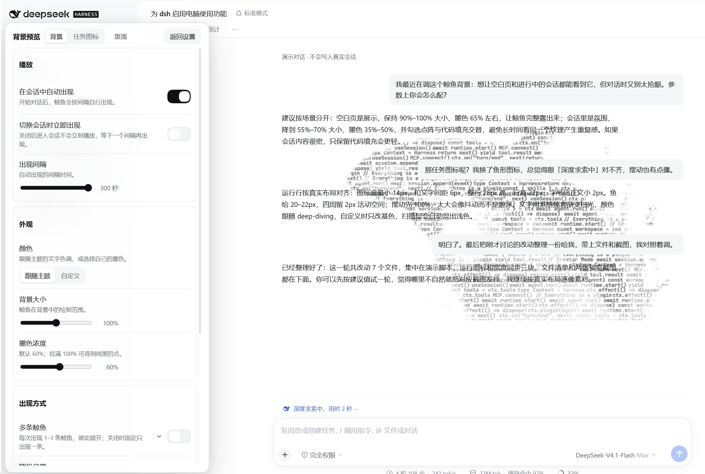

# 鲸跃

[](https://github.com/yingyu4451/dsh-whale-leap/releases)
[](https://github.com/deepseek-ai/deepseek-harness)

[English](README.md) · [简体中文](README.zh.md)

让 DSH 0.2.2-rc.2 新增的鲸跃壁纸动画在已经进行的对话里也能出现，将运行状态行「深度求索」左侧的小尾巴替换成DeepSeek Logo 动画。



## 预览

「实时预览」会隐藏设置窗口，在真实会话里循环播放，并浮出控制条，边看边调；空白首页还没有真实会话时，会挂上一段演示对话与运行状态行，让动画在接近真实的布局里被判断。

## 功能

- **背景鲸鱼**：点阵、代码填充、字符、二进制、线条五种填充，可多选轮换；墨色可跟随主题或自定义；支持背景大小、墨色浓度、水平/垂直位置。
- **多条鲸鱼**：「多条鲸鱼」开启后一次出现 1–3 条，彼此不重叠；随机位置时分开散落并保证整段跃起可见，关闭随机位置时按固定编队居中，可用水平/垂直位置整体平移。出现时机可选同时出现或各自随机时间；远近墨色让越远的鲸鱼墨色越浅；大小范围控制最远到最近的尺寸（20%–100%）。
- **任务图标**：可替换「深度求索」左侧的小鱼图标，提供游动、探索、首页游动、左右轻摆四种动作；图标颜色、文字颜色、图标大小（8–28 px）、文字大小（11–20 px）、起始位置与摆动幅度都可调。
- **手风琴式设置**：从属设置收在父开关下面。父开关打开时自动展开，关闭时收起；点父开关旁的展开箭头可以单独展开预览子项，子项在父开关关闭时保持禁用。
- **设置即预览**：所有外观控制在浮层里调整，浮层使用半透明磨砂、描边与阴影，和页面内容明显区分；按 `Esc` 或「返回设置」即可恢复设置窗口。
- **一键升级**：检查更新会并行查询 GitHub Release 与 jsDelivr 镜像；发现新版本时点「升级」会把标签解析成 commit，并通过 DSH 插件管理器重装到该版本（失败自动回滚）。重启提示按运行环境区分：浏览器里提示重启 `dsh web`，桌面端提示重启 DSH 应用。
- **每日检查**：每天首次打开鲸跃设置时自动检查一次更新，同一天再次打开不会重复请求。
- 界面跟随 Harness 语言，内置简体中文、English、日本語、Español、Français、Deutsch、Русский、Português 八种语言。

## 安装

从 GitHub 安装：

1. 打开 Harness 网页端的 **插件**。
2. 选择 **添加插件**，填入 `github:yingyu4451/dsh-whale-leap`。
3. 重启一次 `dsh web`，然后刷新页面。
4. 打开 **设置 › 鲸跃**。

从本地目录安装（开发调试时）：

```bash
dsh plugin --profile <profile> add /path/to/dsh-whale-leap
```

之后重新构建时，把新的构建覆盖到 `$DSH_HOME/profiles/<profile>/node_modules/dsh-whale-leap`，重启 `dsh web` 即可；也可以在「插件」里移除后重新添加。

## 更新

设置页头部显示当前版本与「检查更新」按钮。检查到新版本时会显示「升级」按钮：点击后把标签解析成 commit，通过 DSH 插件管理器重装到该版本（安装失败会自动回滚），完成后重启 `dsh web` 加载新版本。插件管理器不可用或检查失败时，保留打开 Release 页面的链接，并区分限流、网络不可达、超时等原因。

## 设置

设置页只保留播放控制、每个标签页上方的预览画布和「实时预览」入口；所有外观控制在实时预览浮层里调整，浮层背景为半透明磨砂并带描边与阴影，与页面内容区分。

### 播放

| 选项 | 含义 |
| --- | --- |
| 在会话中自动出现 | 开始对话后，鲸鱼是否按间隔自行出现。 |
| 切换会话时立即出现 | 关闭后，进入会话不会立刻播放，而是等下一个间隔。仅在自动出现开启时可用。 |
| 出现间隔 | 「分」「秒」两个下拉框，5 秒–59 分 59 秒。仅在自动出现开启时可用。 |
| 随机间隔 | 开启后每次随机等待 5 秒–60 分钟，忽略固定间隔；此时「出现间隔」下拉框禁用。默认关闭。 |

### 外观

| 选项 | 含义 |
| --- | --- |
| 颜色 | 跟随主题或自定义墨色。 |
| 背景大小 | 场景缩放 50%–150%。 |
| 墨色浓度 | 10%–100%；100% 为纯黑的点。 |
| 填充样式 | 点阵、代码填充、字符画、二进制、线条，可多选；启用的样式按顺序交替出现，至少保留一项。 |

### 出现方式

| 选项 | 含义 |
| --- | --- |
| 多条鲸鱼 | 一次出现 1–3 条鲸鱼；关闭时固定只出现一条。 |
| 出现时机 | 同时出现（几条一起跃出）或各自随机时间（每条单独起跳）。仅在多条鲸鱼开启时可用。 |
| 大小范围 | 多条鲸鱼从最远到最近的尺寸，20%–100%。仅在多条鲸鱼开启时可用。 |
| 远近墨色 | 越远的鲸鱼墨色越浅，便于区分远近。仅在多条鲸鱼开启时可用。 |
| 随机位置 | 开启后每条鲸鱼都换位置，并保证整段跃起完整可见；关闭时以固定编队居中。 |
| 水平位置 / 垂直位置 | 固定位置时的整体偏移，各 −200 到 +200 px。仅在随机位置关闭时可用。 |

### 任务图标

浮层「任务图标」标签里可调整：替换任务状态图标（开关）、图标颜色、文字颜色、图标大小、文字大小、水平/垂直位置（各 −12 到 +12 px）、摆动方式与摆动幅度（50%–200%）。文字大小只改字号，不改变行高与内边距。

## 快捷操作

- 点击会话空白处：背景鲸鱼重播一次。
- 浮层「重播」：立即重放预览。
- 按 `Esc` 或「返回设置」：退出实时预览，恢复设置窗口。

## 行为与限制

- 仅网页端。插件注册 `conversation.hero.frame`、`conversation.chat.running.mark` 与 `settings.section`，需要 `ui-conversation`、`ui-chat`、`ui-settings`。
- 任务图标优先通过 `conversation.chat.running.mark` 插槽替换；官方构建没有该插槽时改用 DOM 适配器挂载并隐藏原图标，开关关闭后原图标恢复。
- 设置是工作区级的，保存在分区命名空间 `whale-leap`。
- 帧图集随包内置（webp → data URL），离线可用；画布后备缓冲区上限 500 万像素。
- 多条鲸鱼使用非点阵填充时，每条鲸鱼先在离屏画布上按自身轮廓遮罩再合成，不会互相擦除或留下裁切竖线。
- 减少动态效果开启时，所有播放与摆动停止。
- 「首页游动」不受摆动幅度影响；代码文字字号随场景宽度等比缩放，预览与真实会话比例一致。

## 构建

```bash
pnpm install        # esbuild、react 与 Host 侧 schemastery 开发副本
pnpm run build      # 生成 ModuleLoader 产物 lib/client.js
pnpm run check      # 构建 + smoke + 渲染 + Host 路由检查
```

`lib/client.js` 内嵌帧图（webp → data URL）与版本号；Host 半部分 `index.js` 只从运行中的 profile 引入 `@deepseek-ai/schemastery` 并注册设置页。

## 发布

GitHub 是发布与更新的唯一来源：设置页比较仓库最新的 Release（没有 Release 时退回标签）。

1. `pnpm run release:patch`（或 `release:minor` / `release:major`）提升版本、提交并创建 `vX.Y.Z` 标签。
2. `git push --follow-tags`。
3. `gh release create vX.Y.Z --title "vX.Y.Z" --notes "…"`。

## 目录

```text
index.js                     Host：Config schema、settings.configure 与图集路由
shared/settings.js           两半共享的字段名、范围与默认值
src/client/index.tsx         客户端入口：注册三个插槽
src/client/atlas.ts          内置帧图的 data URL
src/client/store.ts          设置运行时（镜像 + 防抖写入）
src/client/i18n.ts           8 种语言词典
src/client/platform.ts       网页端 / 桌面端检测
src/client/settings/         设置页与模块 CSS
src/client/whale/            鲸鱼画布、渲染器、代码填充、鱼形图标与路径
src/client/update.ts         GitHub Release 检查
src/client/upgrade.ts        一键升级（解析标签为 commit，经插件管理器重装）
docs/images/                 README 截图
locale/*.json                插件管理器标题/描述/详情元数据
```

## 致谢与许可

鲸鱼渲染器、代码填充、鱼形路径与任务图标动画改编自 [DeepSeek Harness](https://github.com/deepseek-ai/deepseek-harness)（MIT License，Copyright (c) 2026 DeepSeek），帧图集来自同一仓库并随本包分发。完整许可与改编清单见 [THIRD-PARTY-NOTICES.md](THIRD-PARTY-NOTICES.md)。

本插件为非官方项目，与 DeepSeek 无隶属关系，也未获其背书。MIT 许可只授予著作权相关权限，不授予 DeepSeek 名称、标识或素材上的商标权。
